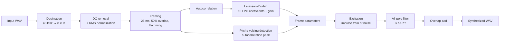

# LPC_speech_synthesizer

A from-scratch implementation of an **LPC-based source–filter speech synthesizer** (LPC-10 vocoder style) in Python. The project covers the full analysis–synthesis chain: resampling, preprocessing, framing, linear predictive analysis, voiced/unvoiced detection, excitation generation and all-pole filter synthesis.

The core DSP building blocks (anti-aliasing resampler, autocorrelation, Levinson–Durbin recursion, pitch/voicing detection) are written by hand with NumPy. SciPy is used only for filtering with the resulting coefficients and for I/O helpers.

> **Note on terminology.** The all-pole LPC filter models the spectral envelope of speech, whose resonances correspond to vocal-tract **formants**. This project does not track formants explicitly; they are represented implicitly by the LPC coefficients. See [Future work](#future-work) for an explicit formant-synthesis extension.

---

## Table of contents

- [How it works](#how-it-works)
- [Features](#features)
- [Default parameters](#default-parameters)
- [Results](#results)
- [Limitations](#limitations)
- [Future work](#future-work)
- [References](#references)
- [License](#license)

---

## How it works



### Signal model

Each frame is modelled as the output of an all-pole filter driven by an excitation signal:

```
s[n] = G · e[n] − Σ_{k=1..10} a_k · s[n−k]
```

- **Voiced frames** – `e[n]` is a periodic impulse train with period `fs / f0`.
- **Unvoiced frames** – `e[n]` is white Gaussian noise.
- **Coefficients** `a_k` are found by solving the normal equations with the Levinson–Durbin recursion on the frame's autocorrelation sequence. The final prediction error energy is used for the gain `G`.

### Per-frame parameters

| Parameter | Description |
|-----------|-------------|
| `lpc`     | 10 LPC coefficients (all-pole filter) |
| `gain`    | Prediction error energy used for scaling the excitation |
| `voiced`  | Voiced / unvoiced decision (1 / 0) |
| `f0`      | Fundamental frequency estimate in Hz |

---

## Features

- **Custom resampler** – windowed-sinc FIR anti-aliasing filter (Hamming window) with rational up/down factors.
- **Preprocessing** – DC offset removal and RMS normalization against a reference level.
- **Framing** – configurable frame length and hop with zero-padding and windowing.
- **Autocorrelation and Levinson–Durbin** – implemented without `scipy.linalg` or `librosa`.
- **Voiced/unvoiced classification** – normalized autocorrelation peak within the 70–400 Hz pitch range.
- **Synthesis** – impulse/noise excitation, per-frame LPC filtering, overlap-add reconstruction.
- **Visualization and playback** – waveform, spectrum and autocorrelation comparison plus in-notebook audio players.

---

## Default parameters

| Parameter | Value | Notes |
|-----------|-------|-------|
| Target sampling rate | 8 kHz | Telephone-band, as in LPC-10 |
| LPC order | 10 | Typical for 8 kHz speech |
| Frame length | 25 ms | 200 samples at 8 kHz |
| Hop size | 12.5 ms | 50% overlap |
| Window | Hamming | Applied at analysis |
| Resampling filter length | 121 taps | Windowed sinc, cutoff at 95% of the new Nyquist |
| Pitch range | 70–400 Hz | Search range for the autocorrelation peak |
| Voicing threshold | 0.28 | Normalized autocorrelation peak, tuned empirically |

---

## Results

Audio samples: [`audio/original.wav`](audio/original.wav), [`audio/decimated_8k.wav`](audio/decimated_8k.wav), [`audio/synthesized.wav`](audio/synthesized.wav).

---

## Limitations

This is an educational implementation intended to expose the mechanics of the LPC vocoder, so the output has the characteristic "buzzy" quality of classic LPC-10 synthesis. Known limitations:

- **Simple excitation** – a plain impulse train with no glottal pulse shaping, and the pulse phase is reset in every frame.
- **Hard voiced/unvoiced decision** – no mixed excitation for voiced fricatives.
- **No parameter smoothing or interpolation** between frames.
- **Fixed voicing threshold** – tuned on a single recording, not adaptive.
- **Pure-Python autocorrelation** – readable but slow; an FFT-based or vectorized version would be much faster.
- **No pre-emphasis** before LPC analysis.
- **Synthesis windowing** – frames are overlap-added without a synthesis window, which can introduce amplitude modulation.

---

## Future work

- Explicit formant extraction from LPC polynomial roots (`numpy.roots`) and a Klatt-style cascade/parallel formant synthesizer.
- Pre-emphasis and de-emphasis.
- Glottal source models (e.g. Rosenberg or LF) and mixed excitation.
- Parameter interpolation and pitch-synchronous synthesis.
- Vectorized or FFT-based autocorrelation, cepstral pitch detection.
- Objective evaluation: log-spectral distance, LPC cepstral distance.
- Parameter coding / quantization for a complete low-bit-rate vocoder.

---

## References

1. L. R. Rabiner, R. W. Schafer, *Digital Processing of Speech Signals*, Prentice Hall, 1978.
2. J. Makhoul, "Linear Prediction: A Tutorial Review", *Proceedings of the IEEE*, 63(4), 1975.
3. T. Tremain, "The Government Standard Linear Predictive Coding Algorithm: LPC-10", *Speech Technology*, 1982.
4. D. H. Klatt, "Software for a cascade/parallel formant synthesizer", *JASA*, 67(3), 1980.

---

## License

Released under the MIT License. See [LICENSE](LICENSE) for details.

> The sample recordings in `audio/` are included for demonstration only. Make sure you have the right to publish any voice recording you add to this repository.
